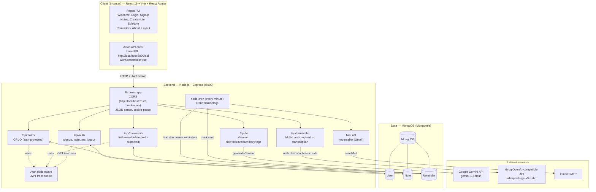

# NoteHaven — AI Notes App

NoteHaven is a full-stack notes application built with React, Node.js, Express, and MongoDB. Users can create, view, edit, and delete notes, with AI-assisted title generation.

## Tech Stack

- React + Vite
- React Router
- Tailwind CSS
- Node.js + Express
- MongoDB
- OpenAI API

## Features

- Create notes
- View saved notes
- Edit notes
- Delete notes
- AI title suggestions
- Responsive navbar and footer

## Architecture



- **Auth**: local signup/login issues a JWT stored in an HTTP-only cookie; protected routes use auth middleware.
- **Core data**: user-scoped notes and reminders stored in MongoDB via Mongoose models.
- **AI & voice**: `/api/ai` uses Google Gemini (`GEMINI_API_KEY`); `/api/transcribe` uploads audio with Multer and transcribes via Groq Whisper (`GROQ_API_KEY`).
- **Reminders**: a cron job runs every minute to email due reminders via Nodemailer (`SMTP_USER`/`SMTP_PASS`) and mark them sent.

## Setup

1. Install backend dependencies:

```bash
cd Server
npm install
```

2. Install frontend dependencies:

```bash
cd client
npm install
```

3. Create a `.env` file in `Server` with:

```env
MONGO_URI=your_mongodb_connection_string
OPENAI_API_KEY=your_api_key
PORT=5000
```

4. Start backend:

```bash
cd Server
node server.js
```

5. Start frontend:

```bash
cd client
npm run dev
```